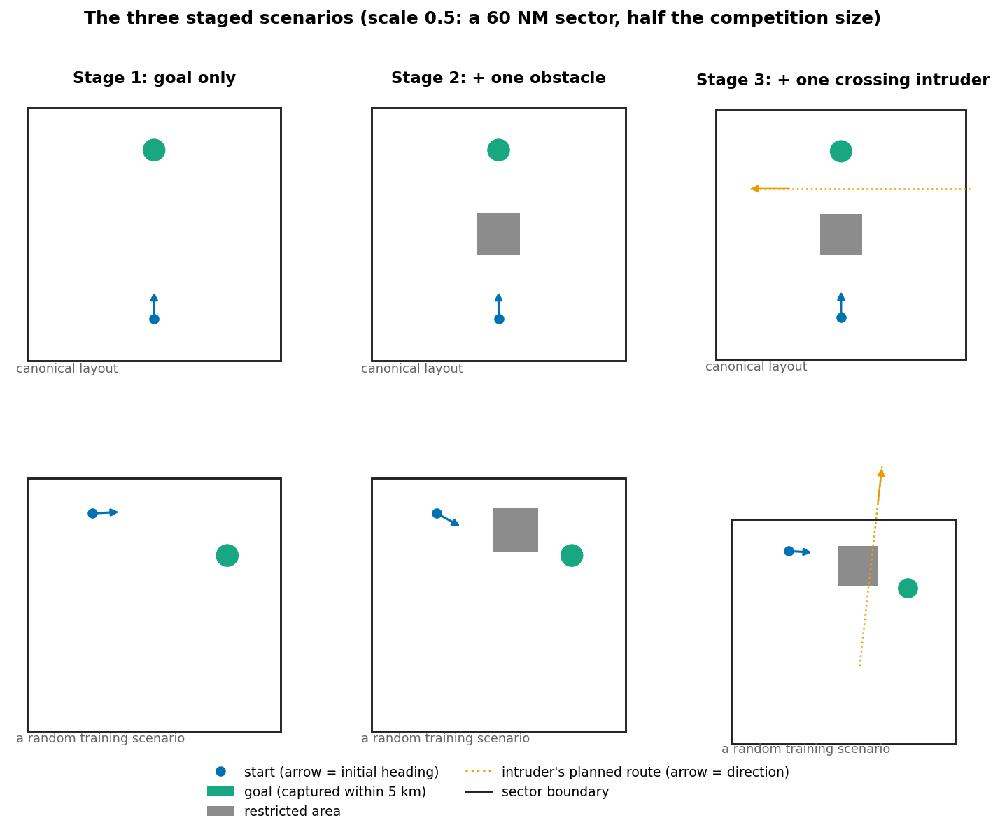
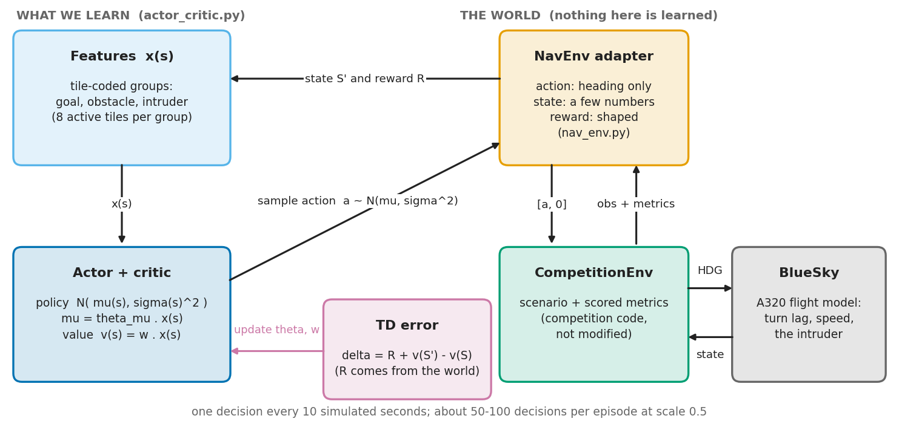
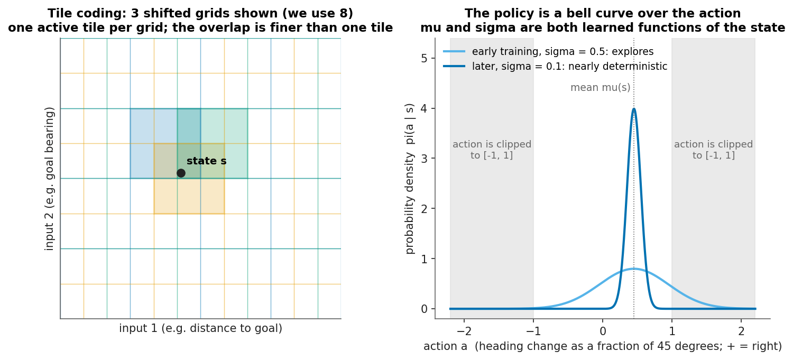
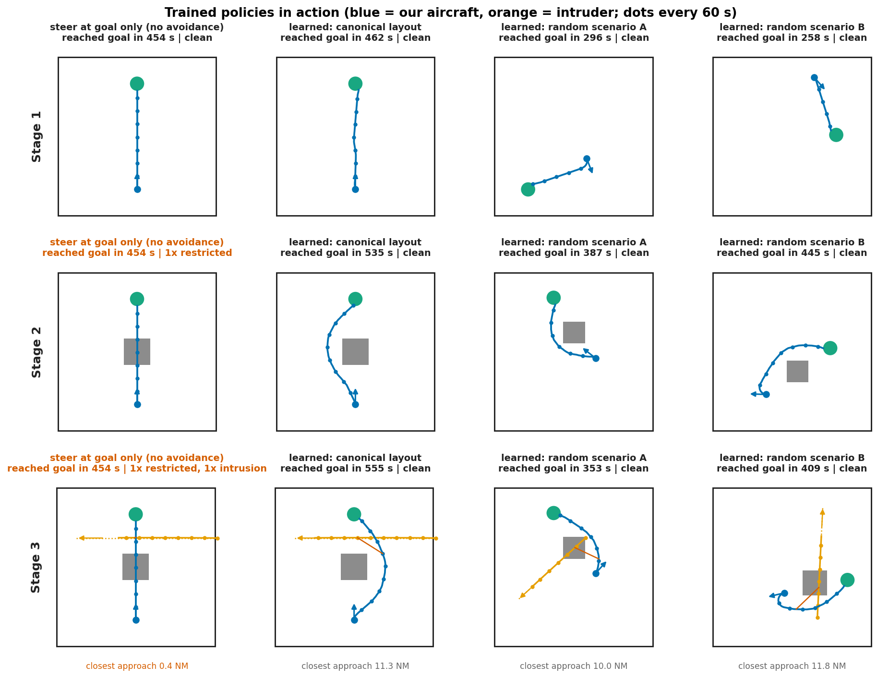
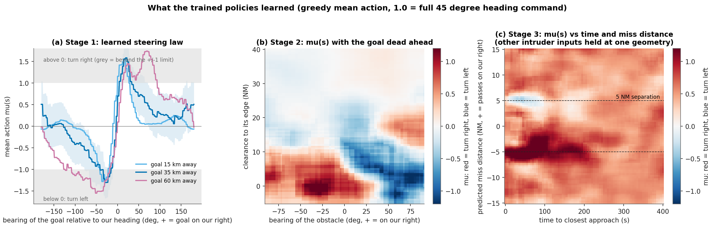
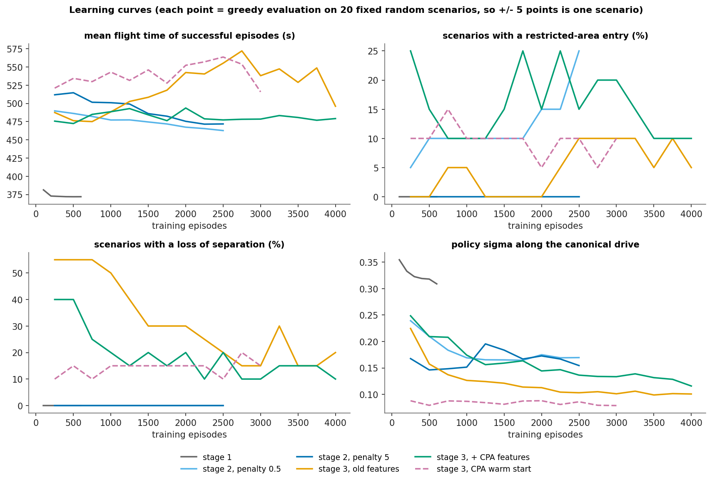
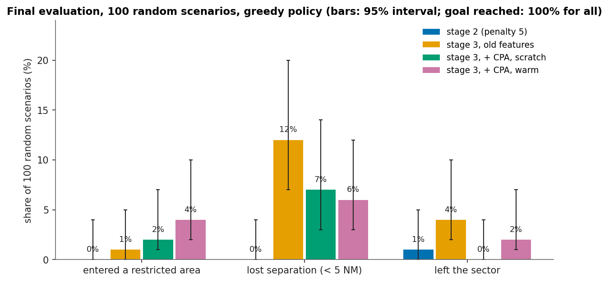

# What we built and why: actor-critic on the competition environment

This document explains, from the ground up, what the code in `policy_gradient/` does, how it
relates to the Dubins-car work in `policy_optimization`, how it relates to other policy-gradient
methods (including the PPO baseline the competition ships), and what the competition tasks look
like. Every figure is generated from the saved checkpoints by
[`make_figures.py`](make_figures.py), so nothing here is a mock-up.

**One-paragraph summary.** The competition asks for a reinforcement-learning agent that flies one
(later ten) aircraft to a goal while avoiding other aircraft, restricted areas and the sector
edge. We did *not* start from the full problem. We built three small scenarios inside the
competition's own environment (goal only, plus an obstacle, plus a crossing intruder) and trained
the same **one-step actor-critic with a Gaussian policy** that we used on the Dubins car
(Sutton & Barto, Chapter 13). The algorithm is unchanged; what changed is the world it acts in
(a real flight simulator, relative observations, scenarios that differ every episode, moving
traffic) and the features we hand it. Section 6 lists what is still missing before this is a
competition entry.

**Contents**
1. [The competition task](#1-the-competition-task)
2. [Our staged scenarios](#2-our-staged-scenarios)
3. [The method, step by step](#3-the-method-step-by-step)
4. [Dubins car vs. this work](#4-dubins-car-vs-this-work)
5. [Where this sits among policy-gradient methods](#5-where-this-sits-among-policy-gradient-methods)
6. [What we learned, and what is still missing](#6-what-we-learned-and-what-is-still-missing)
7. [How to reproduce and explore](#7-how-to-reproduce-and-explore)
8. [Self-check questions](#8-self-check-questions)

---

## 1. The competition task

(Source: [`docs/competition/COMPETITION.md`](../docs/competition/COMPETITION.md).)

You control aircraft heading and speed in a 2-D sector. An episode ends when the aircraft gets
within **5 km** of its goal, or truncates after **3000 simulated seconds**. Nothing else ends an
episode: touching an obstacle or another aircraft does not stop the run, it is only *counted*.

| | Single-agent `CompetitionEnv-v0` | Multi-agent `CompetitionZooEnv` |
|---|---|---|
| API | Gymnasium | PettingZoo `ParallelEnv` |
| You control | 1 aircraft | 10 aircraft |
| Other traffic | 10 scripted intruders on fixed routes | the other 9 learning agents |
| Obstacles | 5 | 5 |
| Role | main testing ground | main scoring goal |

**The scored metrics** (reported per aircraft in `info`, evaluated on the first 1000 episodes of
seed 42): `waypoint_reached`, `intrusion_events` / `intrusion_time` (loss of separation = closer
than **5 NM**), `restricted_area_events` / `time_in_restricted_area`,
`sector_exit_events` / `time_outside_sector`, and `flight_time`. A good entry reaches the goal
nearly always, drives every safety metric to zero, and keeps flight time low.

**What you may change:** the observation (`_get_obs`), the reward (`_get_reward`), the action
mapping and rate (`_get_action`, `d_heading`, `d_speed`, `action_frequency`), and the algorithm
itself, provided it is reinforcement-learning based. **What is fixed:** 2-D flight (no altitude),
the scoring layer, separation/capture radii, the time budget, and the scenario distribution used
for evaluation.

Judging is on novelty, performance and report quality; the deliverables are a 3-4 page report,
a short video on 5 scenarios, and shareable code. Deadline: 30 November 2026.

### The environment's default observation and action

A `Dict` of 131 numbers (single-agent): waypoint drift and distance (3), own airspeed (1),
7 numbers for each of 10 intruders (70), 4 numbers for each of 5 obstacles (20), and 37 numbers
describing the sector boundary. The action is `Box(-1, 1, shape=(2,))`: the first number scales a
heading change (times 45 degrees), the second a speed change. `[0, 0]` keeps heading and speed.

---

## 2. Our staged scenarios

The idea was to climb toward the competition in small, checkable steps, with each stage adding
exactly one new difficulty. [`scenarios.py`](scenarios.py) builds each stage from the same
`Scenario` dataclasses the competition generator uses, so the unmodified `CompetitionEnv` flies
them.



*Top row: the fixed ("canonical") layout of each stage. Bottom row: a random scenario from the
generator used for training (random start, goal, initial heading, obstacle position and, in
stage 3, intruder timing). The blue arrow is the initial heading.*

| | Stage 1 | Stage 2 | Stage 3 |
|---|---|---|---|
| New difficulty | reach a goal from any pose | go around an obstacle | avoid a crossing aircraft |
| Obstacles / intruders | 0 / 0 | 1 / 0 | 1 / 1 |
| What must be learned | steer toward the goal | steer *away* from the obstacle | time a detour around the intruder |

**These are smaller than the real task.** Everything is drawn at *scale 0.5* (a 60 NM sector,
goals 40-75 km away, obstacles roughly 7-12 NM wide). The competition uses sectors of roughly
15,000-23,000 NM2, goals 100-170 km away, obstacles of 500-1500 NM2, **5** obstacles and **10**
intruders. We shrank the geometry because BlueSky costs about one millisecond per simulated
second, so episodes are slow; smaller scenarios are simply shorter episodes. A `--scale 1.0`
option exists for full size.

---

## 3. The method, step by step

### 3.1 The loop



*Left: the part that learns. Right: the part that does not. At every decision (every 10
simulated seconds) the agent turns the world's state into features, samples a heading command,
the simulator moves the aircraft, and the resulting reward drives a small update.*

### 3.2 The policy is a bell curve over the action

For each state `s` the agent outputs a Gaussian over the heading command `a`:

```
pi(a | s) = Normal( mu(s), sigma(s)^2 )
mu(s)    = theta_mu    . x(s)          # a weighted sum of features
sigma(s) = exp( theta_sigma . x(s) )   # exp of another weighted sum, so always > 0
```

`x(s)` is a long vector of mostly zeros (see 3.3), so each of these is a sum of just a few
numbers. The action `a` is clipped to [-1, 1] when sent to the simulator; the update uses the
unclipped sample. A command of +1 means "turn right by 45 degrees from the current heading".



*Left: how a state becomes features (3.3). Right: early in training sigma is wide, so the agent
tries many headings; later sigma narrows, and the policy is nearly deterministic.*

### 3.3 Features by tile coding

The policy and the value function are both *linear* in `x(s)`. To make linear functions
expressive enough, `x(s)` is built by **tile coding** (book Section 9.5.4): several shifted grids
are laid over the input space, a state falls into exactly one tile of each grid, and `x(s)` has a
1 for each of those tiles and a 0 everywhere else. We store only the indices of the ones.

[`actor_critic.py`](actor_critic.py) uses these groups (each with 8 grids):

| Group | Inputs | Active from |
|---|---|---|
| goal | distance to goal, bearing of goal | stage 1 |
| obstacle | clearance to nearest obstacle's edge, its bearing | stage 2 |
| obstacle + goal | goal bearing, obstacle bearing, clearance | stage 2 |
| intruder | distance, bearing, aspect of nearest intruder | stage 3 |
| closest approach (`--cpa`) | time to closest approach, signed miss distance (and again with goal bearing) | stage 3 |

**Every angle is measured relative to the aircraft's own heading** (positive = on the right).
That is what lets "steer toward the goal" be learned once and work anywhere; the sector's shape
changes every episode, so absolute coordinates would not transfer.

The *closest approach* pair deserves a sentence: if both aircraft keep their current velocity,
when will they be closest (`tcpa`) and how close (`dcpa`)? A conflict is decided by these two
numbers, not by where the intruder is right now. We compute them from the body-frame position
and velocity the environment already gives us.

### 3.4 The learning rule: one-step actor-critic

A second linear function, the **critic** `v(s) = w . x(s)`, predicts how good a state is. After
every step the agent computes the **TD error**:

```
delta = R + v(S') - v(S)        # (gamma = 1; v(S') = 0 at the goal)
```

`delta` is "how much better or worse than predicted did that step go?". Then three updates:

```
w        <- w        + alpha_w     * delta * x(S)                     # critic: fix the prediction
theta_mu <- theta_mu + alpha_mu    * delta * (a - mu) * x(S)          # actor: shift the mean
theta_sg <- theta_sg + alpha_sigma * delta * ((a-mu)^2/sigma^2 - 1) * x(S)
```

(Each step size is divided by the number of active tiles. The `mu` step uses `(a - mu)` instead
of the textbook `(a - mu)/sigma^2`; the extra `sigma^2` makes it a natural-gradient step for a
Gaussian mean and stopped the policy collapsing when sigma got small. This is the same trick as in
the Dubins version.)

The reading of the actor update: if `delta > 0` the sampled action was better than expected, so
move `mu` toward it; if `delta < 0`, move away from it. The `sigma` update widens the bell when
extreme samples turn out well and narrows it when they turn out badly. That is the policy
gradient, `delta * grad ln pi(a|s)`, with the critic supplying a low-noise "better or worse"
signal on every step instead of waiting for the episode to end.

### 3.5 The reward

Defined in [`nav_env.py`](nav_env.py), in units of 100 seconds:

```
reward = ( -dt                          # every second flown costs 1 second
         + (d - d') / v                 # progress toward the goal, as seconds saved
         + 500 * [goal reached]
         - 1    * seconds in violation  # restricted area, outside sector, loss of separation
         - 500 * new violation events )   # (event penalty 5 in the runs reported below)
         / 100
```

The progress term is **potential-based shaping** (Ng, Harada & Russell 1999) with potential
`-d / v`. It gives feedback on every step and, with gamma = 1, provably does not change which
policy is best. The violation terms are read straight from the competition's own scored metrics,
so we are penalising exactly what is measured.

**A lesson about penalties.** Our first stage-2 run used an event penalty of 0.5. The policy
learned to clip the obstacle corner on 25% of random scenarios, because a short clip cost less
than the detour it saved. That is the reward working as written, not a bug: the agent optimises
the reward we gave it. Raising the penalty to 5 removed the clipping (0% entries) at a cost of
about 9 seconds of flight time. Reward design is where most of the care goes.

---

## 4. Dubins car vs. this work

| | Dubins car (`policy_optimization`) | CompetitionEnv + BlueSky (here) |
|---|---|---|
| Dynamics | hand-written kinematics, instant steering | BlueSky A320 model: turn lag, speed hold, autopilot |
| State the agent sees | its own absolute pose `(x, y, theta)` | **relative** quantities only: goal bearing/distance, nearest obstacle, nearest intruder |
| Action | steering rate, `[-1, 1]` | a *heading command* relative to the current heading, held for 10 s |
| Decision rate | every 0.1 s, ~200 steps for 20 s | every 10 s, ~50-100 steps per episode |
| World | one fixed 10 x 10 arena, 4 circular obstacles, fixed goal | a different random sector, goal and obstacle **every episode** |
| Other agents | none | moving traffic (scripted intruders; later learning agents) |
| Collision | **terminal**, -10 penalty | **not terminal**: counted as a metric, we penalise it per second / per event |
| End of episode | goal, crash, or 20 s | goal, or 3000 s |
| Map-specific features | yes: tiles on absolute `(x, y, heading)` learn "steer away from *this* obstacle" | no: the map changes, so every feature is relative to the aircraft |
| Scoring | your own return | fixed objective metrics, independent of your reward |

**What did not change:** the algorithm (Gaussian policy, one-step actor-critic, tile coding,
potential-based shaping, gamma = 1), most hyperparameters, and the habit of evaluating on a fixed
set of random scenarios plus one fixed layout.

**The conceptual shift.** In the Dubins car the agent can memorise a map: it sees the same
obstacles every time. Here the agent has to learn a *rule* ("when an obstacle is close and to my
right, turn left"). That is why the learned policies look like the maps below, not like a route.

---

## 5. Where this sits among policy-gradient methods

**First, a clarification: what we built *is* a policy-gradient method.** The contrast worth
drawing is between *kinds* of method, and between *this implementation* and the "deep"
policy-gradient methods the competition's example uses.

```
Reinforcement learning
|
+-- value-based (learn q(s, a); the policy is "pick the best action")
|     Sarsa, Q-learning, DQN                    <- your gridworld work (needs discrete actions)
|
+-- policy-gradient (learn the policy directly; adjust its parameters up the gradient of return)
      |
      +-- REINFORCE            wait for the episode's return; high variance
      +-- REINFORCE + baseline subtract v(s) to cut variance
      +-- actor-critic         learn v(s) too; use the TD error each step        <-- what we built
      +-- modern deep variants A2C / PPO / SAC: same ideas, neural networks, batches of data
```

**vs. value-based (Sarsa / Q-learning).** Those learn a table or function `q(s, a)` and act
greedily. They need a small, discrete action set; our heading command is continuous, and a
discretised version would need an action per heading step. Policy gradients handle continuous
actions directly, since the policy is a distribution you can sample from.

**vs. REINFORCE.** REINFORCE multiplies the gradient by the *whole episode's return*, so one
good or bad step is drowned in the noise of everything else in the episode. The critic lets us use
the one-step TD error instead: much lower variance, at the cost of some bias.

**vs. the competition's PPO example.** The competition ships PPO from Stable-Baselines3
(`train_zoo.py`: `n_steps=512`, `batch_size=128`, `gamma=0.99`, `gae_lambda=0.95`, MLP policy).
Both are policy-gradient actor-critics. They differ in implementation:

| | Our actor-critic | PPO (the competition example) |
|---|---|---|
| Function approximator | linear on hand-built tile-coded features | neural network on the raw observation |
| Input | a few engineered numbers (nearest obstacle, nearest intruder) | the full 131-number observation |
| Update schedule | after **every step**, one sample | collect a batch of steps, then several passes of minibatch updates |
| Step-size control | small fixed step sizes | clipped objective that limits how far one update can move the policy |
| Advantage estimate | one-step TD error | GAE (blends many steps) |
| Exploration noise | state-dependent `sigma(s)`, learned | typically one learned noise level shared across states |
| Strength | transparent: you can plot what it learned (figure below) | handles any input, scales to many intruders without feature design |
| Weakness | needs features designed by hand; cannot see 10 intruders | opaque; needs far more data |

(The PPO column describes the settings in the competition guide and Stable-Baselines3's usual
behaviour; we have not run it here.)

**Both are on-policy.** Like Sarsa, the policy is optimised for how it behaves *with its own noise
on*, but we evaluate it *without* noise (the mean action). A policy trained under noise tends to
prefer wide margins; evaluating at the mean is a slightly different, usually tighter, policy. The
sigma shown in the learning curves (0.08-0.17 at the end) is not tiny, so this gap is real.

**No guarantee of the best policy.** The policy-gradient theorem gives a direction that improves
expected return, but with function approximation and noise the climb stops at a local optimum.
We see this directly: stage 3 settles with a few percent of conflicts rather than zero.

---

## 6. What we learned, and what is still missing

### What the trained policies do



*Rows are stages. Column 1 is a controller that steers at the goal and ignores everything else (it
hits the obstacle and the intruder). Columns 2-4 are the learned policy on the canonical layout
and two random scenarios. Blue dots every 60 s; orange is the intruder; the red line joins the two
aircraft at their closest approach.*

The learned policies fly wide arcs around the obstacle and turn behind or ahead of the intruder.
They are slower than flying straight (535 s vs. 454 s on the stage-2 canonical layout), which is
the price of staying clear.

### What the policy learned, in a picture



*Greedy mean action `mu(s)`. Red = turn right, blue = turn left; the action is clipped at +/-1.
**(a)** Stage 1: the steering law. The curves are roughly "turn toward the goal" (noisy, because they come from tiles), and the grey
bands are beyond the limit (clipped). **(b)** Stage 2, goal dead ahead: an obstacle that is close
and on the right (bottom right) makes the policy turn left, and one on the left makes it turn
right; far-away obstacles do nothing. It learned "steer away". **(c)** Stage 3: a much noisier
map. The strongest response is a hard right turn when the intruder would pass on our *left* within
about 5 NM and soon (tcpa under ~200 s). The other side of the map is not a clean mirror image.
Treat (c) as honest evidence that the intruder rule is only partly learned; the other intruder
inputs are held at one geometry, so it is a slice, not the whole story.*

### How training went



*Each point is a greedy evaluation on only 20 scenarios, so one scenario is 5 points: read the
trends, not the wiggles.*

Stage 1 learns in roughly 100 episodes. Stage 2 is stable after the penalty fix. Stage 3 cuts
conflicts from about 55% to 15-20% over training, and the closest-approach features (green) get
there faster.

### Final numbers (100 random scenarios, greedy policy)



| | Goal | Restricted entry | Intrusion | Sector exit | Mean time |
|---|---|---|---|---|---|
| Stage 2 (penalty 5) | 100% | 0% | 0% | 1% | 469 s |
| Stage 3, old features | 100% | 1% | 12% | 4% | 486 s |
| Stage 3, + closest-approach, from scratch | 100% | 2% | 7% | 0% | 481 s |
| Stage 3, + closest-approach, warm start | 100% | 4% | 6% | 2% | 496 s |

The 95% intervals on the intrusion rate overlap (7-20%, 3-14%, 3-12%), so the closest-approach
features are an improvement we believe in, not one we have proven.

### What is still missing before this is a competition entry

1. **Scale.** All results are at half size, with 1 obstacle and 1 intruder. The competition has 5
   obstacles and 10 intruders in much larger, irregular sectors. Nothing here has been evaluated
   on the competition's seed-42 distribution, so **these numbers are not comparable to anyone's
   competition score.**
2. **Features cannot see 10 intruders.** Our hand-built features look at the *nearest* obstacle and
   intruder. Ten intruders (and, in the multi-agent track, nine other learners) need either a
   richer feature design or a neural network that reads the observation directly. The
   actor-critic update itself carries over unchanged to a neural-network policy.
3. **Speed is held fixed.** We only learn heading; the competition allows speed too.
4. **Intrusions are not at zero.** About 7% of stage-3 scenarios still lose separation, and
   obstacle and intruder avoidance are separate feature groups, so the policy cannot weigh one
   against the other.
5. **Multi-agent** is the stated high-value target and is not started. With many learners sharing
   a policy, each agent's world changes as the others learn, which on-policy actor-critics
   handle less gracefully.
6. **Novelty and the report.** The judges score novelty and write-up. A hand-featured actor-critic
   is a clear, explainable baseline and a good teaching tool; it is not by itself an original
   contribution.

---

## 7. How to reproduce and explore

Run from PowerShell at the repository root. Only one BlueSky environment can exist per process, so
each run handles one stage.

```powershell
# train (checkpoints go to policy_gradient/checkpoints/, which git ignores)
uv run python -m policy_gradient.train --stage 1 --episodes 600 --eval-every 100
uv run python -m policy_gradient.train --stage 2 --episodes 2500 --event-penalty 5 --out policy_gradient/checkpoints/stage2_ep5.npz
uv run python -m policy_gradient.train --stage 3 --cpa --episodes 4000 --event-penalty 5 --out policy_gradient/checkpoints/stage3_cpa.npz

# measure on 100 scenarios, with 95% intervals
uv run python -m policy_gradient.train --stage 3 --cpa --evaluate --eval-n 100 --out policy_gradient/checkpoints/stage3_cpa.npz

# watch it (a pygame window; do not set SDL_VIDEODRIVER=dummy)
uv run python -m policy_gradient.train --stage 3 --cpa --watch --out policy_gradient/checkpoints/stage3_cpa.npz

# regenerate every figure in this document
uv run python -m policy_gradient.make_figures --recollect
```

The checkpoints are not in git; the figures are made from whatever is in
`policy_gradient/checkpoints/`.

| File | Role |
|---|---|
| [`scenarios.py`](scenarios.py) | the three stages, canonical and random |
| [`nav_env.py`](nav_env.py) | Dubins-style adapter: 1-D action, small state, shaped reward |
| [`actor_critic.py`](actor_critic.py) | tile coding, Gaussian policy, one-step actor-critic |
| [`train.py`](train.py) | `--stage`, `--cpa`, `--watch`, `--evaluate`, penalty flags |
| [`make_figures.py`](make_figures.py) | every figure above |
| [`explainer.html`](explainer.html) | the interactive version of this document: open it in any browser, no server needed |
| [`build_explainer.py`](build_explainer.py), [`explainer_template.html`](explainer_template.html) | rebuild `explainer.html` from the checkpoints (`python -m policy_gradient.build_explainer`) |

---

## 8. Self-check questions

If you can answer these without looking, you understand the system.

1. **Why is a Gaussian policy used instead of picking from a list of headings?** The heading
   command is continuous, and a distribution can be sampled and differentiated directly.
2. **What does `delta` (the TD error) mean, and what does the actor do with it?** It is how
   much better or worse the step went than the critic predicted; the actor makes the sampled
   action more likely if `delta > 0` and less likely if `delta < 0`.
3. **Why does `sigma` shrink?** Noisy steering costs reward, so the gradient narrows `sigma`. Nothing
   forces it; the policy sharpens because sharpening pays.
4. **Why are all the angles relative to the aircraft's heading?** The scenario changes every
   episode, so a rule has to hold anywhere; absolute coordinates would not transfer.
5. **Why is the progress reward added and why does it not change the best policy?** It is
   potential-based shaping with potential `-d / v`; it adds feedback every step without changing
   which policy has the best return (exact for gamma = 1).
6. **What caused the 25% obstacle entries, and what fixed them?** A penalty smaller than the
   detour cost: the agent was following the reward. A larger event penalty fixed it.
7. **Is what we built a policy-gradient method?** Yes: an actor-critic. The contrast with the
   competition's PPO example is the function approximator (linear tile coding vs. a neural
   network), the update schedule (every step vs. batches) and the step-size control, not the
   family.
8. **What, concretely, has to change to go from here to the competition?** Handle 10 intruders
   and 5 obstacles (richer features or a neural network), learn speed too, run at full scale, and
   then multi-agent; and evaluate on the official seed-42 harness.
